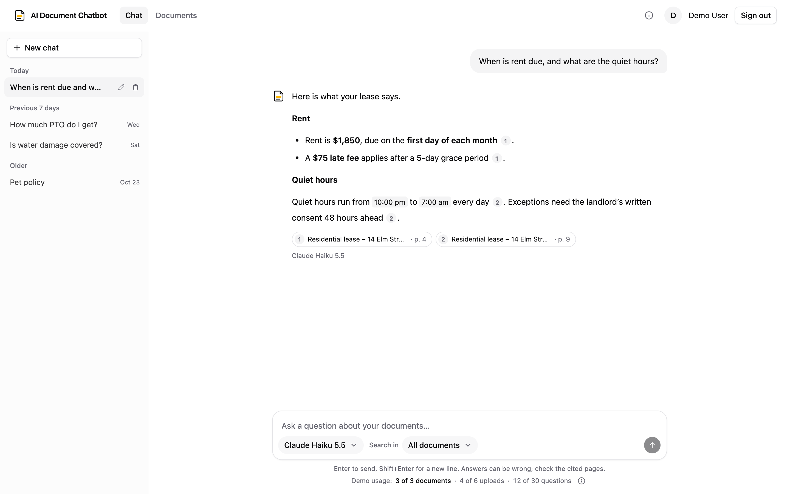
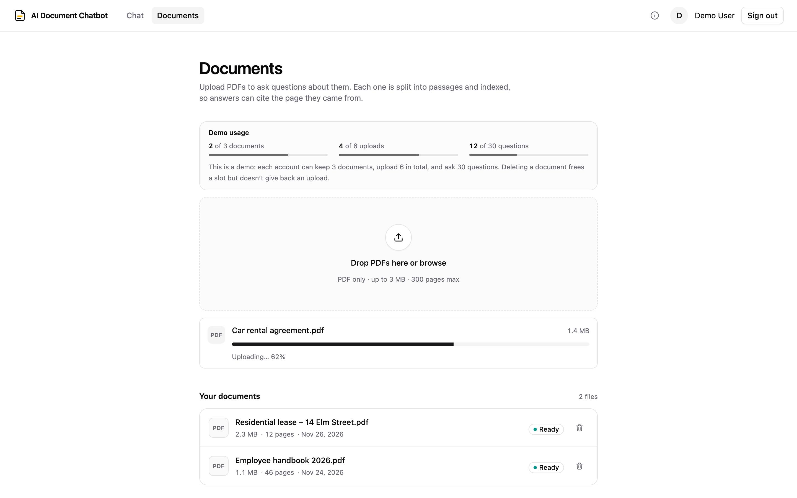
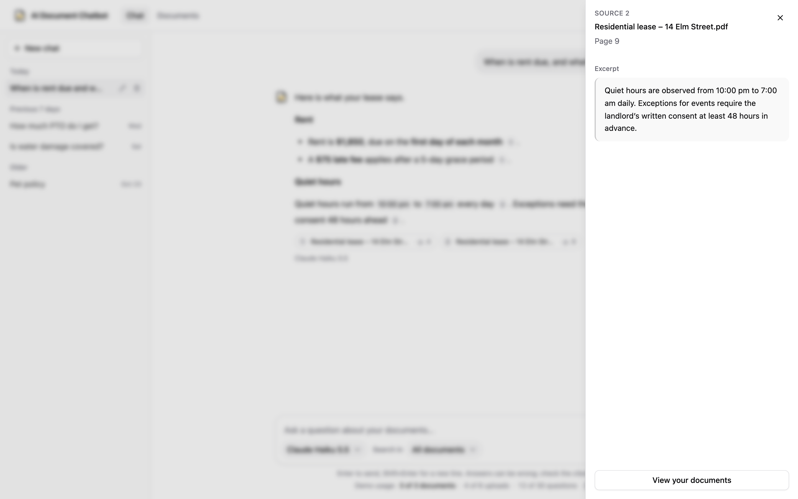
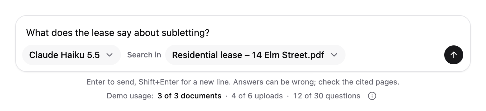
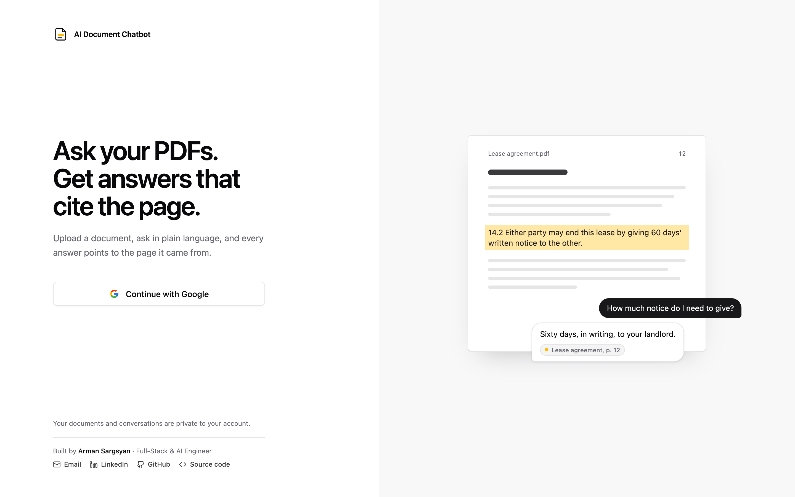
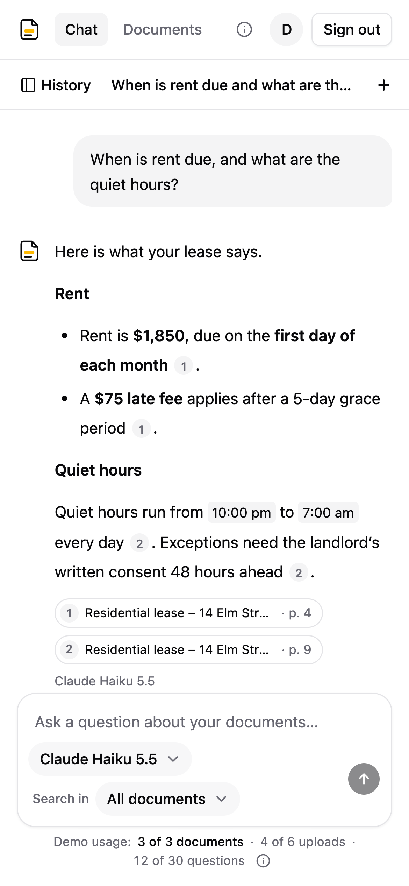
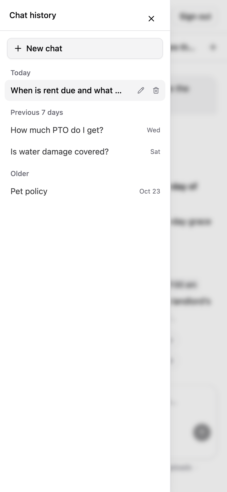
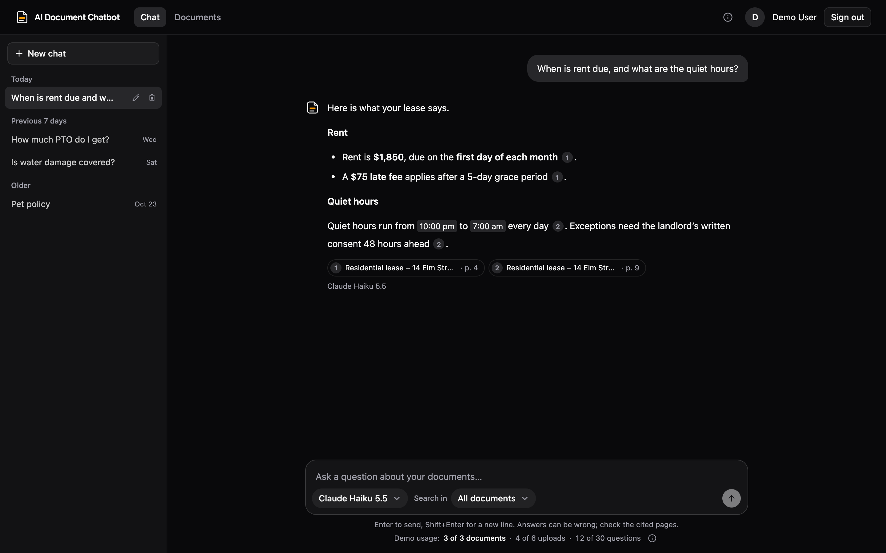
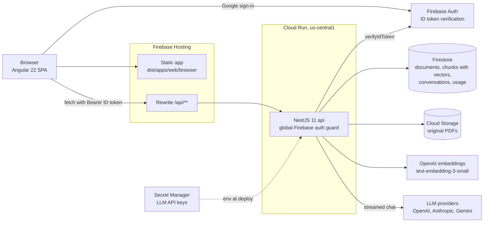
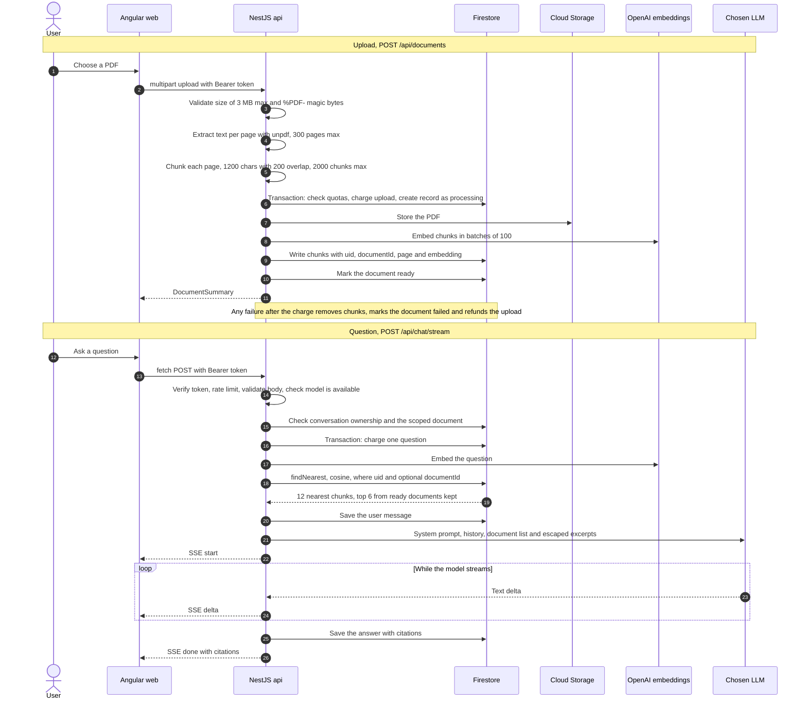

# AI Document Chatbot

Upload PDFs and ask questions about them. Answers stream in from your choice of OpenAI, Anthropic or Gemini models and cite the exact document and page they came from.

**Live demo:** https://ai-doc-chatbot-demo.web.app (sign in with Google)


[](https://github.com/armansargsyan/ai-document-chatbot/actions/workflows/ci.yml)



## Features

- **PDF upload.** Text is extracted, chunked per page and embedded for vector search. Uploads show progress, and scanned, corrupt or password-protected PDFs are rejected with a clear message.
- **Answers grounded in your documents (RAG).** Every claim cites a numbered excerpt, and each citation shows the document name, page and a snippet.
- **Three LLM providers.** Pick GPT-6 Luna (OpenAI), Claude Haiku 5.5 (Anthropic) or Gemini 3.8 Flash (Google) for each question. A model without an API key shows as unavailable.
- **Search scope.** Search all of your documents, or pick a single document with the "Search in" picker.
- **Streaming answers** over server-sent events, rendered as Markdown. You can stop an answer mid-stream.
- **Chat history.** Conversations are saved and can be renamed or deleted.
- **Demo limits and a usage display.** Lifetime per-user quotas, with what you have used shown in the app.
- **Provider spend caps.** When a provider's monthly budget runs out, its models are marked unavailable and requests fail fast instead of erroring upstream.
- **Responsive.** Works on phones: the conversation list moves into a drawer.

## Screenshots

<table>
  <tr>
    <td width="50%"><br><sub>Documents: upload, status, page count</sub></td>
    <td width="50%"><br><sub>Citations with document, page and snippet</sub></td>
  </tr>
  <tr>
    <td width="50%"><br><sub>Model and "Search in" pickers</sub></td>
    <td width="50%"><br><sub>Google sign-in</sub></td>
  </tr>
  <tr>
    <td width="50%" align="center"><br><sub>Mobile chat</sub></td>
    <td width="50%" align="center"><br><sub>Mobile conversation drawer</sub></td>
  </tr>
  <!-- dark mode -->
  <tr>
    <td colspan="2"><br><sub>Dark mode</sub></td>
  </tr>
  <!-- /dark mode -->
</table>

## Architecture



The browser only signs in with Firebase Auth. Firestore and Storage security rules deny all direct client access, so every read and write goes through the api, which uses the Firebase Admin SDK and scopes each query to the caller's `uid`. Hosting and the api share one origin, so there is no CORS.

### RAG flow



Everything that can fail before the first token (validation, model availability, ownership, quotas, retrieval) runs before the SSE headers are sent, so those failures are ordinary HTTP errors. A failure while streaming ends the stream with a single `error` event.

## Tech stack

| Layer    | Technology                                                                                |
| -------- | ----------------------------------------------------------------------------------------- |
| Frontend | Angular 22 (standalone, signals, zoneless), Tailwind CSS v4, spartan/ui, marked           |
| Backend  | NestJS 11 (native ES modules), zod validation, `@nestjs/throttler`                        |
| AI       | OpenAI, Anthropic and Google Gen AI SDKs, `text-embedding-3-small` (1536 dimensions)      |
| Data     | Cloud Firestore with vector search (`findNearest`), Cloud Storage, Firebase Auth (Google) |
| PDF      | unpdf                                                                                     |
| Infra    | Cloud Run, Firebase Hosting, Secret Manager, Cloud Build                                  |
| Tooling  | Nx 24 monorepo, TypeScript 6, Vitest, ESLint, Prettier, GitHub Actions                    |

## Engineering highlights

- **One typed contract for both apps.** Request and response types, SSE event unions, error codes, the model allow-list and demo limits live in `libs/shared`, which has no framework imports. ESLint module-boundary tags stop `web` and `api` from importing each other.
- **Zoneless Angular with signals.** There is no `zone.js`. State lives in `signal` and `computed`, and every component uses `OnPush`. Reads go through `httpResource`, and routes are lazy-loaded.
- **Streaming over POST.** `EventSource` can't send a body or an `Authorization` header, so the client calls `fetch` and parses SSE from a stream reader (`sse-parser.ts`). Closing the connection aborts the upstream model call, and partial answers are never saved.
- **Swappable LLM providers.** Each vendor implements one `LlmProvider` streaming interface. Vendor errors map to generic HTTP errors, so provider messages and account details never reach the client. Per-vendor rules detect a spent budget, and `ProviderQuotaTracker` then fails requests to that provider fast and marks its models unavailable. The pause lifts after an hour or at the next UTC month, whichever comes first.
- **Atomic quotas, fair refunds.** Each upload and question is charged in a Firestore transaction before any paid call is made. A question is refunded only when the provider failed before streaming anything, with a 429, 502 or 503 (calls that weren't billed). Rejected prompts and timeouts may have been billed, so they keep the charge and can't be repeated for free.
- **Prompt-injection hardening.** Excerpts and document names go into the prompt as escaped XML-style data (`<` and `&` are neutralized), so a PDF containing `</excerpt>` can't break out of its wrapper. The system prompt also tells the model to treat them as untrusted.
- **Per-user data scoping.** All data sits under `users/{uid}/…`. Vector search filters on `uid` through a composite vector index, and loading a resource that isn't yours returns 404. Uploads are checked by their content (magic bytes), not by the MIME type the client sends.
- **Runtime Firebase config.** The web build contains no Firebase config. The app fetches it from the public `GET /api/config` at startup, so one build works in any environment.
- **Tests that don't hit the network.** Every project uses Vitest, with fake LLMs, a fake embedder and fake `fetch`. Repository and vector-search specs run against the Firestore and Storage emulators, and they are skipped when the emulators aren't running.

## Demo limits

The live demo spends real API credit, so each user gets lifetime limits (`DEMO_LIMITS` and `MAX_PDF_BYTES` in `libs/shared`):

| Limit                   | Value      |
| ----------------------- | ---------- |
| Documents at once       | 3          |
| Uploads, ever           | 6          |
| Questions, ever         | 30         |
| PDF size                | 3 MB       |
| PDF pages / text chunks | 300 / 2000 |

Deleting a document frees a slot but doesn't give back an upload. On top of the quotas, per-user burst limits default to 10 chat requests a minute and 10 uploads an hour. Each provider also has a hard monthly spend cap set in its dashboard, which the api detects and reports as described above.

## Getting started

**Prerequisites:** Node.js 24 (as in CI and the api's Docker image) and npm. For the emulators you also need the Firebase CLI and Java 11+.

```sh
npm ci
cp .env.example .env   # then fill in the values (see below)
npm start              # serves api (http://localhost:3000/api) + web (http://localhost:4200)
```

`npm start` runs `nx serve web`, which depends on `api:serve`, so both start. `web` proxies `/api` to the Nest server (`apps/web/proxy.conf.json`). Use `npm run start:api` to run only the api.

### Environment variables

The api validates `.env` at startup (`apps/api/src/config/env.schema.ts`). Empty values count as unset.

| Variable                                                                                      | Required    | Purpose                                                                                                |
| --------------------------------------------------------------------------------------------- | ----------- | ------------------------------------------------------------------------------------------------------ |
| `PORT`                                                                                        | no          | api port, default `3000`                                                                               |
| `FIREBASE_PROJECT_ID`                                                                         | yes         | Firebase project for the Admin SDK                                                                     |
| `FIREBASE_API_KEY`, `FIREBASE_AUTH_DOMAIN`, `FIREBASE_APP_ID`, `FIREBASE_MESSAGING_SENDER_ID` | for sign-in | Public web config served by `GET /api/config`. Without it, the login page shows sign-in as unavailable |
| `FIREBASE_STORAGE_BUCKET`                                                                     | no          | Defaults to `<FIREBASE_PROJECT_ID>.firebasestorage.app`                                                |
| `GOOGLE_APPLICATION_CREDENTIALS` or `FIREBASE_CLIENT_EMAIL` + `FIREBASE_PRIVATE_KEY`          | no          | Admin credentials. Otherwise Application Default Credentials are used                                  |
| `OPENAI_API_KEY`                                                                              | for RAG     | Embeddings (uploads and search) and the OpenAI model                                                   |
| `ANTHROPIC_API_KEY`, `GEMINI_API_KEY`                                                         | no          | Enable the Anthropic and Gemini models                                                                 |
| `FIRESTORE_EMULATOR_HOST`, `FIREBASE_AUTH_EMULATOR_HOST`, `FIREBASE_STORAGE_EMULATOR_HOST`    | no          | Point the Admin SDK at local emulators                                                                 |
| `RATE_LIMIT_CHAT_PER_MINUTE`, `RATE_LIMIT_UPLOADS_PER_HOUR`                                   | no          | Per-user burst limits, default `10` each                                                               |

**Without LLM keys** the app still runs: `GET /api/models` reports each model as unavailable and the picker shows it disabled. Uploads and questions need `OPENAI_API_KEY` for embeddings, plus at least one chat model key.

## Firebase

Project: `ai-doc-chatbot-demo` (default in `.firebaserc`). Uses Authentication (Google sign-in), Cloud Firestore (`nam5`, native mode) and Cloud Storage.

- **Security rules** (`firestore.rules`, `storage.rules`) deny all direct client access. The browser only signs in with Firebase Auth; every read and write goes through the NestJS api, which uses the Firebase Admin SDK.
- **Web config**: run `firebase apps:sdkconfig web` and copy the values into the `FIREBASE_*` entries in `.env`.
- **Admin credentials (local)**: run `gcloud auth application-default login`, or point `GOOGLE_APPLICATION_CREDENTIALS` at a service-account key. Never commit the key. With `gcloud` user credentials, also run `gcloud auth application-default set-quota-project ai-doc-chatbot-demo` so quota and billing go to this project.
- **Vector indexes** (`firestore.indexes.json`): two composite vector indexes on the `chunks` collection group, `uid + embedding` and `uid + documentId + embedding` (1536 dimensions, flat).
- **Emulators**: `firebase emulators:start` runs Auth (9099), Firestore (8080) and Storage (9199), with the Emulator UI on http://localhost:4000. To point the api at them, set the `*_EMULATOR_HOST` entries in `.env` (values are in `.env.example`); without them the api talks to the live project. When `FIREBASE_AUTH_EMULATOR_HOST` is set, `GET /api/config` hands the emulator URL to the browser, so the web app signs in against the Auth emulator too (with a fake Google account from the emulator's sign-in popup); leave it empty to sign in with the real project.
- **Deploy rules/indexes**: `firebase deploy --only firestore,storage`.

The project is on the Blaze plan (Cloud Storage requires it) with a $3/month budget alert. The default bucket `ai-doc-chatbot-demo.firebasestorage.app` is in `us-central1`, inside the Cloud Storage free tier.

## Testing

```sh
npm test                    # Vitest for web, api and shared
npx nx test api             # one project
npm run lint                # ESLint, including module-boundary rules
npm run format:check        # Prettier
npx nx affected -t lint test build   # what CI runs, plus format:check
```

Specs ending in `.emulator.spec.ts` (repositories, usage transactions, vector search) run only when the emulators are up:

```sh
firebase emulators:exec --only firestore,storage "npx nx test api"
```

CI (`.github/workflows/ci.yml`) runs `nx format:check` and `nx affected -t lint test build` on Node 24 for every pull request and every push to `main`.

## Deploy

```
Browser ─► Firebase Hosting ─┬─ /        → Angular app (dist/apps/web/browser)
                             └─ /api/**  → Cloud Run "api" (us-central1) ─► Firestore · Storage · Auth · LLM APIs
```

- **api**: Cloud Run service `api` in `us-central1`, built from `apps/api/Dockerfile` (Node 24) on Cloud Build. Runs as the `api-runtime` service account, which only has Firestore access (`roles/datastore.user`) and object access on the default bucket. Max 2 instances (caps cost and keeps the in-memory rate limits meaningful), scales to zero, 1 GiB, 300 s timeout.
- **web**: Firebase Hosting. `/api/**` is rewritten to Cloud Run (same origin, no CORS). Hashed JS/CSS are cached for a year; HTML is `no-cache`.
- **Config**: the deploy script sets the public Firebase web config as Cloud Run env vars. LLM keys come from **Secret Manager**, never from files.

Note: requests through Hosting are limited to **60 s**. Typical answers and PDFs finish well within that; very large uploads could hit it.

### Redeploy

```sh
scripts/deploy.sh          # api + web
scripts/deploy.sh api      # Cloud Run only
scripts/deploy.sh web      # Hosting only
firebase deploy --only firestore,storage   # rules / indexes
```

Needs `gcloud` and `firebase` logged in with access to the project. The script always passes `--project ai-doc-chatbot-demo` (override with `PROJECT=…`).

### LLM keys (Secret Manager)

Create each secret in **your own terminal** (the key is read without echoing, so it never lands in shell history or logs):

```sh
P=ai-doc-chatbot-demo
for NAME in OPENAI_API_KEY ANTHROPIC_API_KEY GEMINI_API_KEY; do
  printf '%s (Enter to skip): ' "$NAME"; read -rs KEY; echo
  [ -z "$KEY" ] && continue
  printf '%s' "$KEY" | gcloud secrets create "$NAME" --data-file=- --replication-policy=automatic --project "$P"
  gcloud secrets add-iam-policy-binding "$NAME" --project "$P" \
    --member "serviceAccount:api-runtime@$P.iam.gserviceaccount.com" --role roles/secretmanager.secretAccessor
  unset KEY
done
scripts/deploy.sh api   # attaches the secrets that exist
```

`OPENAI_API_KEY` is required for PDF ingestion (embeddings); at least one of the three enables chat. Secrets that don't exist are skipped and their models show as unavailable. Set a monthly spending limit in each provider's dashboard. To rotate a key: `printf '%s' "$KEY" | gcloud secrets versions add NAME --data-file=-` then `scripts/deploy.sh api`.

## Project structure

```
apps/
  web/                Angular app
    src/app/core/       auth, runtime config, layout, usage
    src/app/features/   chat, documents, login
  api/                NestJS app, one module per domain
    src/              auth, chat, documents, embeddings, retrieval, llm,
                      conversations, usage, rate-limit, config, firebase
libs/
  shared/             framework-free types, DTOs and limits used by both apps
  ui/                 spartan/ui helm primitives (@spartan-ng/helm/*)
scripts/deploy.sh     Cloud Run + Hosting deploy
firebase.json         Hosting rewrites, emulators
firestore.indexes.json  vector indexes
```

Useful extras: `npx nx graph` shows the project graph, and `npx nx g @spartan-ng/cli:ui <name>` adds a spartan/ui primitive.

## Author

**Arman Sargsyan**, Full-Stack & AI Engineer

[LinkedIn](https://www.linkedin.com/in/arman-sargsyan-a12a17153/) · [GitHub](https://github.com/armansargsyan)

## License

[MIT](LICENSE) © 2026 Arman Sargsyan
